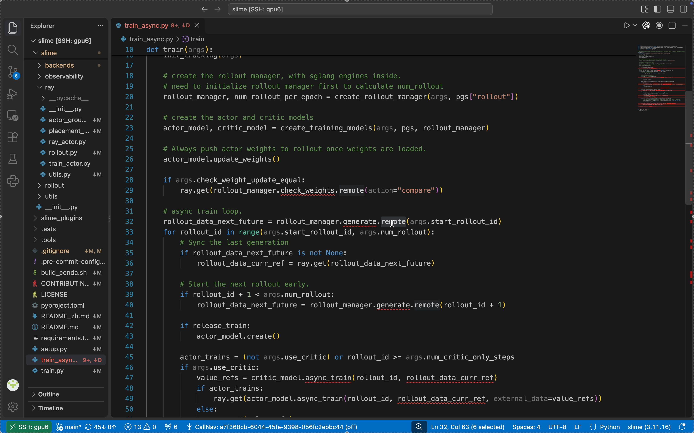

# Track Any Call

**Demo 1: Ray Actor remote method dispatch**



**Demo 2: Configuration-driven function dispatch**


Track Any Call records Python calls at runtime to show which implementation a dynamically bound call actually used. For functions loaded from registries or subclass methods called through abstract interfaces, you can jump from the call site in VS Code to the implementation observed during the run.

[中文](README.zh-CN.md) · [Usage guide](docs/usage.md) · [How it works](docs/architecture.md)

## Install

Requires **Python 3.11+** on the workspace host and **VS Code 1.85+**.

Download [`callnav.vsix` from the latest release](https://github.com/Zethan06/Track_any_call/releases/latest/download/callnav.vsix) and install it using **Extensions: Install from VSIX…**. The recorder is bundled; no pip installation or source checkout is needed. With Remote-SSH, install the extension on the remote host.

To build from source, run `python vscode/scripts/package.py` in this repository.

## Use

1. Open a **new VS Code terminal**, activate your usual Python environment, and run your launch command from the project directory with a `callnav` prefix:

   ```bash
   callnav bash ./launch.sh
   # Or:
   callnav python train.py --steps 1
   ```

2. Run **CallNav: Select Recording…** and choose a completed run.
3. **Ctrl/Cmd+click** a call to open the implementation observed in that run.

If `callnav` is unavailable, run **CallNav: Enable Terminal Command** and open a new terminal. You can also right-click a `.sh` or `.py` file and choose **CallNav: Record Script…**; successful editor captures load automatically.

Recordings are kept in `.callnav/`. Record again after changing source. Only executed, successfully captured calls have runtime destinations; C/CUDA internals are outside the recording scope. See the [usage guide](docs/usage.md) for Ray setup, external source directories, and standalone CLI installation.

[Development and tests](CONTRIBUTING.md) · [MIT license](LICENSE)
