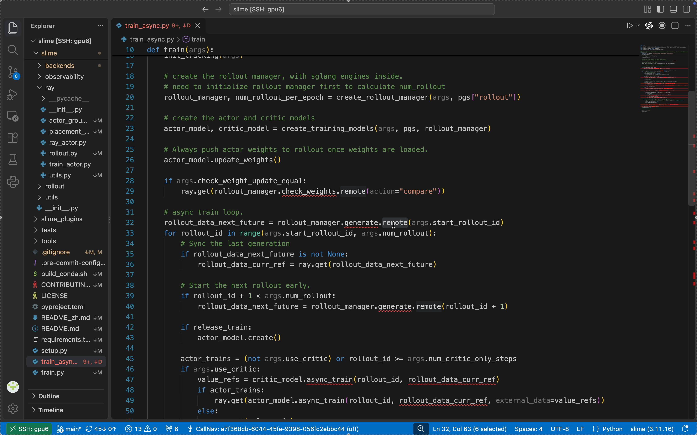

# Track Any Call



Track Any Call 记录 Python 运行时的函数调用，用来确定动态绑定后实际执行的是哪个实现。遇到注册表加载的函数、抽象接口背后的子类方法等调用，可以在 VS Code 中根据本次运行的记录跳到实际执行的函数。

录制器、安装包和编辑器命令目前都叫 CallNav。

[English](README.md) · [详细用法](docs/usage.md) · [实现原理](docs/architecture.md)

## 安装

需要工作区主机上的 **Python 3.11+** 和 **VS Code 1.85+**。

从成功的 [Checks 构建](https://github.com/Zethan06/Track_any_call/actions/workflows/checks.yml)下载并解压 `callnav-release`，在 VS Code 执行 **Extensions: Install from VSIX…**，安装其中的 `.vsix`。插件内置录制器，无需 pip 安装或克隆源码。Remote-SSH 用户将插件安装到远程主机。

从源码打包：在本仓库运行 `python vscode/scripts/package.py`。

## 使用

1. 打开一个**新的 VS Code 终端**，激活原有 Python 环境，进入项目目录，在启动命令前加上 `callnav`：

   ```bash
   callnav bash ./launch.sh
   # 或：
   callnav python train.py --steps 1
   ```

2. 执行 **CallNav: Select Recording…**，选择一次已完成的运行。
3. **Ctrl/Cmd+点击**调用位置，跳到这次运行实际执行的实现。

若找不到 `callnav` 命令，执行 **CallNav: Enable Terminal Command** 后新开终端。也可以右键 `.sh` 或 `.py` 文件，选择 **CallNav: Record Script…**；成功后自动载入记录。

历史记录保存在 `.callnav/`，修改源码后需重新录制。仅支持本次实际执行并成功采集的调用，不包含 C/CUDA 内部调用。Ray 配置、外部源码目录和独立 CLI 安装见[详细用法](docs/usage.md)。

[开发与测试](CONTRIBUTING.md) · [MIT 许可](LICENSE)
